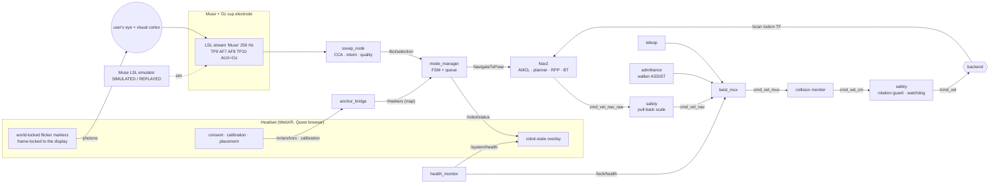
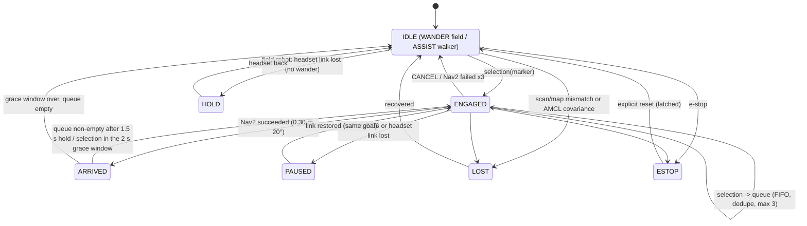
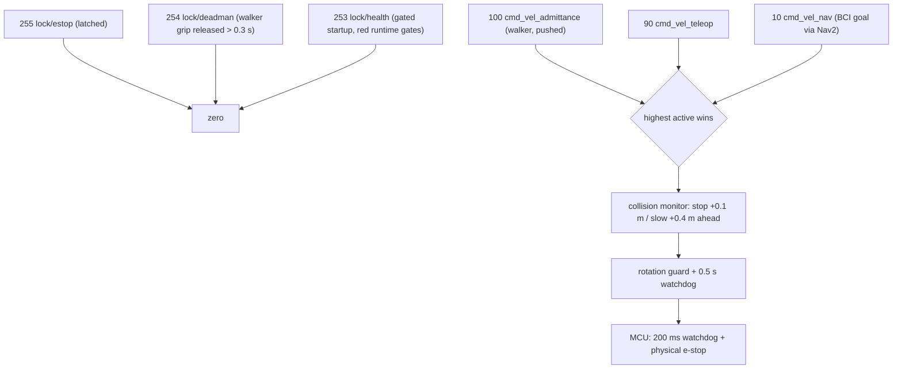
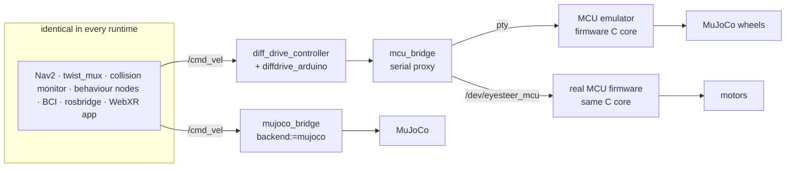
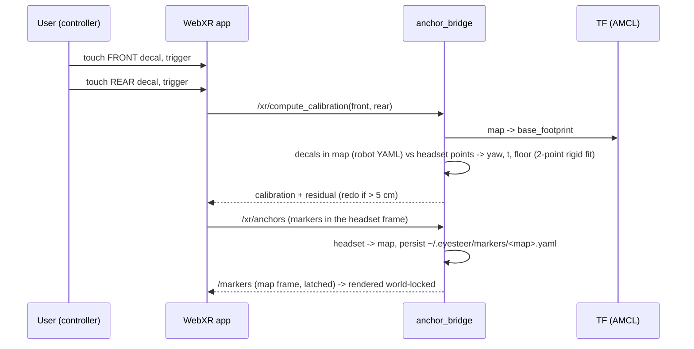

# Architecture

One codebase, three runtimes. The logic Steve sees in the videos is the logic on the robot:
decoding, intent, FSM, queue, mux priorities, admittance and footprints live in the ROS-free package
**`eyesteer_core`**; the ROS 2 nodes are thin wrappers; the standalone sim imports it directly.

| runtime | what runs | used for |
|---|---|---|
| **C: standalone** | `standalone/` + `eyesteer_core`, MuJoCo, built-in A*/pure-pursuit (Nav2 stand-in), synthetic EEG | presentation videos, fast tests, `preflight` sim check |
| **A: ROS sim** (`backend:=mujoco`) | full ROS 2 stack + `mujoco_bridge` as the robot driver | the demo in sim, scenario tests in ROS |
| **A2: ROS HIL** (`backend:=mujoco_hil`) | + MCU emulator (firmware C core on a pty) → `mcu_bridge` → `ros2_control` + `diffdrive_arduino` | closest-to-real rehearsal, full-system golden path |
| **B: real** | identical upper stack on the Jetson; real MCU, LiDAR, Muse | demo day |

## Dataflow



**The BCI never outputs velocities** (D7): `ssvep_node` emits selection events, `mode_manager` turns them into
`NavigateToPose` goals; Nav2 and the safety layers own all motion.

## Mode manager FSM



Selection ≠ intent (D3): a selection needs argmax = m for N = 3 consecutive 2 s windows (0.25 s step),
ρ ≥ θ = 0.40, margin ≥ δ = 0.08, the engagement gate, and a 2 s per-marker refractory period; otherwise NO-CONTROL.

## Velocity arbitration (HI controllability)



The human always wins: e-stop > dead-man > handle force > teleop > BCI navigation. In ENGAGED, pulling back on
the walker's handles scales the nav command down (≥ 12 N) to zero (≥ 30 N).

## Sim / real backend swap (D15, D20)



`sim.launch.py backend:=mujoco|mujoco_hil` vs `real.launch.py`: only the bottom layer changes.

## TF tree

```mermaid
flowchart TB
  map -->|AMCL / slam_toolbox| odom
  odom -->|bridge (sim) / diff_drive_controller (HIL, real)| base_footprint
  base_footprint --> base_link
  base_link --> laser_frame
  base_link --> imu_link
  base_link --> camera_link --> camera_optical_frame
  base_link --> left_wheel_link
  base_link --> right_wheel_link
  base_link --> casters
  base_link --> handle_left_ft --> grip_left
  base_link --> handle_right_ft --> grip_right
```

## Headset ↔ map calibration



## Topics, actions, services
See [INTERFACES.md](INTERFACES.md) for the full contract (types, rates, QoS, frames) at every boundary.

## Gated startup
`health_monitor` publishes `/system/health` (muse_lsl, bci, headset, frequency_table, lidar, tf, localization,
nav2, mcu, safety) and holds the `lock/health` twist_mux lock until every required gate is green; the dashboard
(`/dashboard.html`), the headset panel and the HUD show the same list. `make demo-sim` / `make demo-real`
(`tools/demo.py`) wait for the gates in dependency order with a specific hint for each red one.
