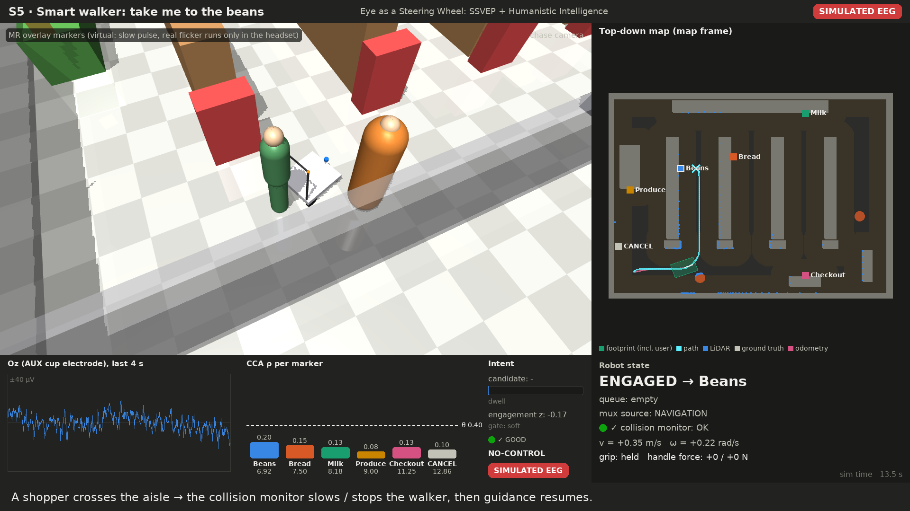
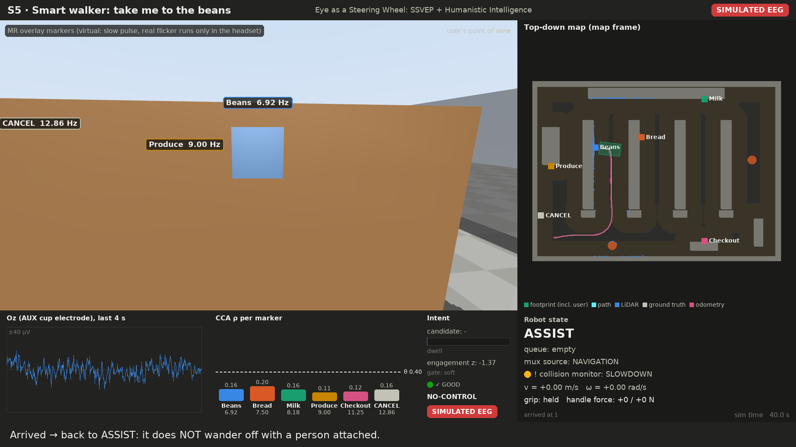
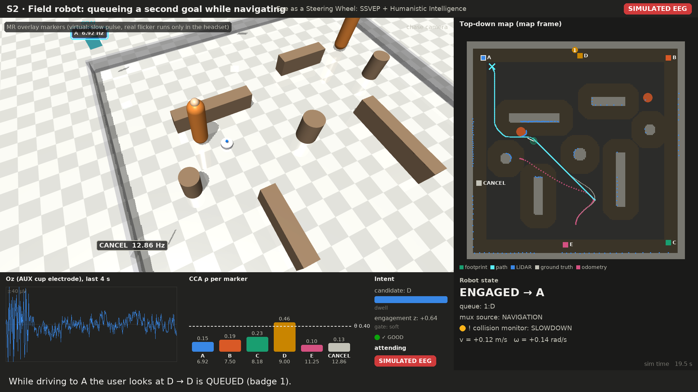

# Eye as a Steering Wheel: one page

**The gap.** *Eye as a Camera* used the eye and visual cortex as a sensor: a flickering square scanned a scene and
the SSVEP picked up by a Muse (plus an Oz cup electrode) reported what the subject saw. It was **read-only**:
sensing without actuation. Nothing acted on what the eye selected.

**The closed loop.** Here what the eye selects becomes where the body is moved. The user looks at a virtual
marker; their visual cortex follows its flicker (SSVEP at Oz); the decoder recognises which marker; the robot (or
a smart walker carrying the user) navigates there.

## Markers live in mixed reality
The flickering markers are **virtual**: world-locked panels in the Quest's passthrough view, placed by the user on
real things ("Beans" on the shelf). The robot never sees them. A two-point calibration (touch two decals on the robot
with the controller) puts them into the robot's map. Each marker flickers at its own frequency, locked to the
display's frame rate: 6.92, 7.50, 8.18, 9.00, 11.25 Hz, plus 12.86 Hz for **CANCEL** (90 Hz display; 10 Hz alpha
and harmonic collisions avoided).

## Humanistic Intelligence: observe and override
- **Observability.** The robot's state (mode, goal, queue, which input is in control, collision-monitor state) is
  always shown in the headset, in RViz and on a health dashboard.
- **Controllability.** Layered overrides, highest first: **e-stop**, then the walker's **dead-man grip**, then
  **handle force** (pull back and it slows), then **teleop**, then the BCI. The BCI **never outputs velocities**: it
  only chooses goals, and Nav2 plus the safety layers own all motion.
- **Looking is not commanding** (no "Midas touch"). A selection needs the same marker for 3 consecutive 2 s windows,
  correlation ≥ 0.40 and a clear margin, with an optional engagement gate. Glances never fire. In 90 s of natural
  looking-around (S3) there were **0 false selections**.

## Autonomous vs. engaged
| state | field robot | walker |
|---|---|---|
| idle | **WANDER**: drifts around the field, avoids obstacles | **ASSIST**: moves only when pushed; it never drives off with a person attached |
| engaged | navigates to the attended marker | guides the user there at walking pace; footprint includes the user |
| during navigation | new selections are **queued** (max 3); a 2 s grace window after arrival still accepts engagement | same |
| CANCEL marker | clears goal and queue → idle | same |

## What is simulated vs. real
| part | in the simulation | on demo day |
|---|---|---|
| EEG | synthetic SSVEP (always labeled **SIMULATED EEG**) over a real LSL stream | Muse + Oz cup electrode via LSL |
| markers | same WebXR app, desktop preview or the Quest | Quest passthrough, placed on real objects |
| decoder, intent, FSM, safety | **identical code** | identical code |
| navigation | Nav2 (ROS sim) / built-in planner (videos) | Nav2 |
| motors, LiDAR | MuJoCo physics + ray-cast LiDAR; HIL runs the real firmware logic | Arduino-class MCU + RPLIDAR |

## From simulation to the robot
1. **Sim:** `make sim world=supermarket robot=walker gaze=headset`. Open the app on the Quest and drive the
   *simulated* walker by looking.
2. **HIL rehearsal:** the same, plus the real hardware-interface path running against an emulated MCU. A full-system
   test passes 5× in a row.
3. **Robot:** `make flash` → `make preflight` (MCU, LiDAR, eyes-closed alpha test, SSVEP smoke test) →
   `make demo-real`. Motion stays locked until every health gate is green.

Videos: `outputs/videos/S1…S6.mp4` · metrics: `outputs/metrics/summary.md` · details: README, ARCHITECTURE, DEMO_DAY.
